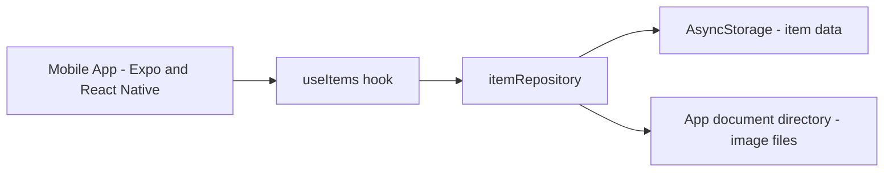

# Gullak

> Drop it in. Find it later.

A *gullak* is the traditional Indian clay piggy bank, a place where you drop small things to keep them safe. Gullak the app does the same for your notes, links, snippets, and images: save them in seconds, then find them again with search, filters, and tags.

**Stage reached: Stage 1 (local-only app).** There is no authentication and no backend. All data stays on the device.

## Runnable build

- **Android APK (Expo build):** https://expo.dev/accounts/parth_2009/projects/gullak/builds/2e5e6059-8150-4912-87f8-2af0d7db7017
  Open the link on an Android phone, tap Install, and allow installs from unknown sources if Android asks.
- Or run it from source (see [How to run](#how-to-run)).

## Features

- Save four kinds of items: **notes**, **links**, **snippets**, and **images**.
- Snippets are shown in a monospace block with one-tap copy.
- Every item has an ID, type, title, content or URL, tags, created and updated dates, and an archived state.
- Create, view, open, edit, and delete items.
- Archive and restore items, with separate Active and Archived views.
- Add tags to items (lowercased, trimmed, duplicates removed).
- Search across title, content, URL, and tags as you type.
- Filter by type (All, Notes, Links, Snippets, Images) and by tag. Search and filters work together.
- Data persists locally and survives closing and reopening the app.
- Handles unusual input: empty notes are blocked, links without `https://` are normalised and validated, empty titles are auto-generated, and very long text does not break the layout.
- Light and dark themes.

## Tech stack

- Expo (React Native) with TypeScript
- expo-router for navigation
- AsyncStorage for local persistence
- expo-image-picker and expo-file-system for images
- expo-haptics and react-native-reanimated for feel and motion
- EAS Build for the Android APK

## How to run

Requirements: Node.js LTS, and the Expo Go app on your phone (same Wi-Fi as your computer).

```
git clone https://github.com/parthgp2009/gullak-byte-task.git
cd gullak-byte-task
npm install
npx expo start
```

Scan the QR code with Expo Go (Android) or the Camera app (iPhone). If your phone cannot connect, use `npx expo start --tunnel`.

To build the APK yourself:

```
npm install -g eas-cli
eas login
eas build -p android --profile preview
```

## Architecture



Stage 1 architecture: Mobile App to Local Storage.

```
app/            screens (expo-router): Inbox, Create, Detail, Edit
src/
  types.ts      Item data model
  theme.ts      colours, spacing, typography tokens
  storage/      itemRepository.ts (all storage access)
  hooks/        useItems (shared state and actions)
  utils/        search, URL and tag normalisation, title derivation, dates
  components/   reusable UI pieces
```

## Important technical decisions

- **Storage behind a repository layer.** Screens never talk to AsyncStorage directly. They call `useItems`, which calls `itemRepository`. Switching to SQLite or a backend later means changing one file, not the UI.
- **Single versioned storage key** (`gullak:items:v1`). The whole item list is stored as JSON. Parsing is wrapped in a safe fallback, so corrupt data returns an empty list instead of crashing the app.
- **One shared source of truth.** `useItems` loads items once on launch and persists after every change, so the Inbox, Detail, and Edit screens never show stale data.
- **Images are copied into the app's document directory.** Picker results are often temporary cache files that can disappear. Copying the file and storing its local path keeps images available after restarts. Deleting an image item also deletes its copied file, and a missing file shows a placeholder instead of crashing.
- **Search and filters combine in sequence.** The list is filtered by archived state, then type, then tag, then the search text, so all of them work together.
- **Link normalisation.** If a URL has no scheme, `https://` is added before validation.
- **Snippet type added without breaking old data.** `snippet` was added to the item type union only. The storage key and the shape of existing items are unchanged, so items saved before the change still load.
- **Reusable form.** Create and Edit share one form component, so validation and behaviour stay identical.

## Known issues and limitations

No known bugs at the time of writing. The items below are limitations of the Stage 1 design.

- Data is stored only on the device. Uninstalling the app or clearing its data deletes everything, and there is no backup or sync.
- There is no authentication, since Stage 1 is single-device by design.
- AsyncStorage is a simple key-value store. It is fine for a personal inbox, but SQLite would suit a very large number of items better.
- The APK is not distributed through the Play Store, so Android shows an "unknown sources" prompt on install.

## Commit history

The repository history shows the work in order: data layer, screens, redesign, and build setup.
